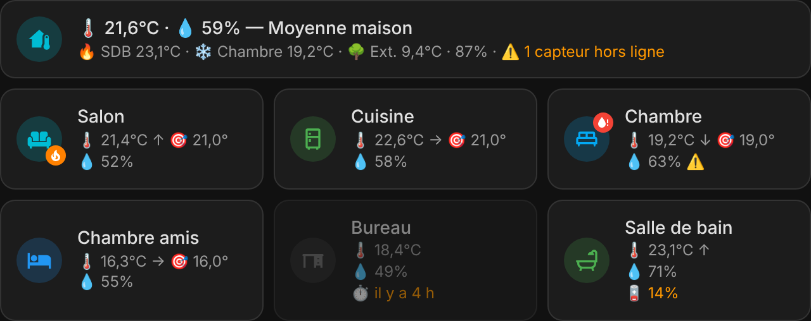
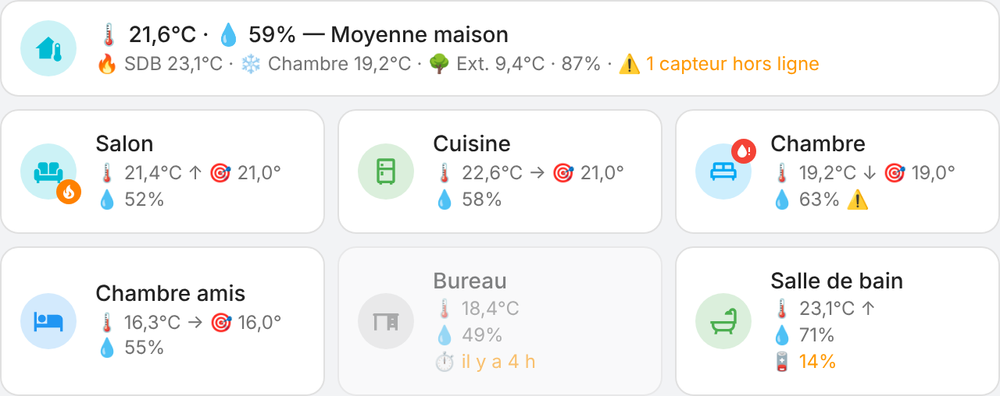
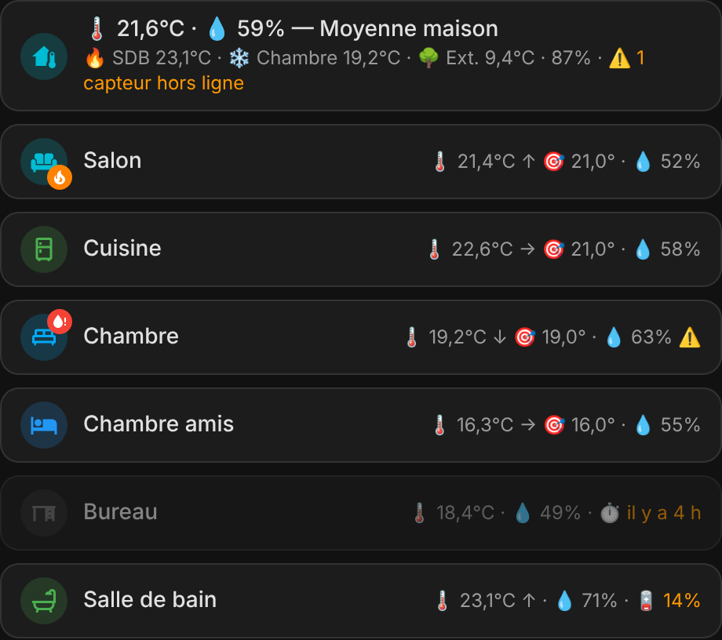
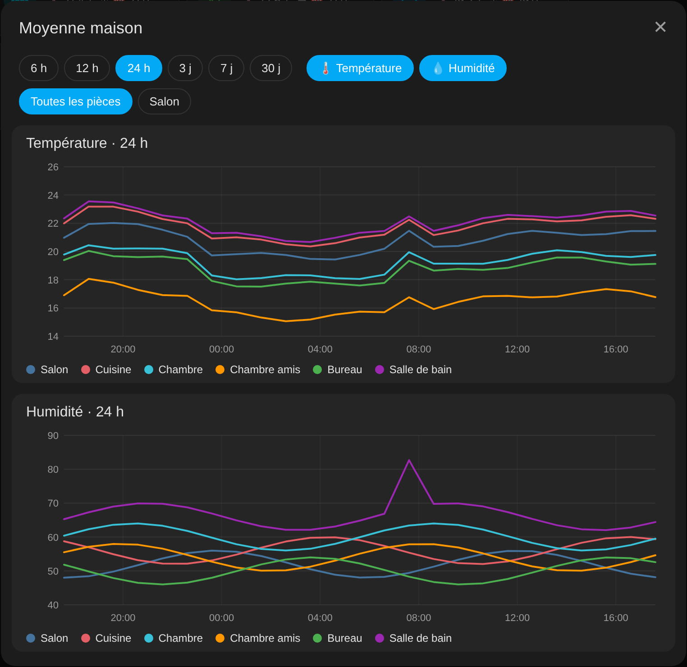

# Climascope Card

🇬🇧 [English version](README.md)

Une carte Lovelace pour Home Assistant qui affiche d'un coup d'œil le climat de toute la maison : moyenne maison, température extérieure et une tuile par pièce (température, humidité, chauffage). Toutes les options se règlent depuis l'éditeur visuel.



<details>
<summary>Autres captures</summary>

| Thème clair | Disposition compacte |
| --- | --- |
|  |  |

Graphique d'historique à l'appui long :



</details>

[](https://hacs.xyz/)

## Fonctionnalités

- **En-tête maison** : température et humidité moyennes, pièce la plus chaude et la plus froide, température extérieure (entité météo ou capteur), alerte en cas de capteur hors ligne.
- **Tuiles par pièce** : température, humidité, couleur selon des seuils de température, badge d'alerte d'humidité.
- **Chauffage** : consigne du thermostat (🎯), badge chauffe / refroidit, préréglage en option. Le toucher sur la tuile ouvre le thermostat.
- **Flèche de tendance** : ↑ ↓ → par rapport à la valeur d'il y a une heure, avec un seuil réglable.
- **Santé des capteurs** : les capteurs injoignables ou qui n'envoient plus de mesure sont grisés, et la batterie faible est signalée.
- **Exclure une pièce** des statistiques de l'en-tête (chambre d'amis, bureau peu utilisé…).
- **Seuils d'humidité par pièce**, par exemple plus stricts pour la salle de bain.
- **Disposition compacte** : une ligne par pièce.
- **Actions au toucher et à l'appui long**, avec une entité au choix pour chaque pièce.
- **Graphique d'historique à l'appui long** : température et/ou humidité, de 6 h à 30 jours, pour toutes les pièces ou une seule.
- **Éditeur visuel** pour toutes les options, en français et en anglais.

## Installation

### HACS (dépôt personnalisé)

1. HACS → ⋮ → **Dépôts personnalisés**.
2. Ajoute `https://github.com/Geoffrey33/Climascope`, type **Dashboard**.
3. Recherche **Climascope Card**, télécharge-la, puis recharge le navigateur.

### Manuelle

1. Copie `climascope-card.js` dans `/config/www/`.
2. Paramètres → Tableaux de bord → ⋮ → **Ressources** → ajoute `/local/climascope-card.js` en **Module JavaScript**.
3. Recharge le navigateur en vidant le cache.

## Configuration

Le plus simple est de passer par l'éditeur visuel : ajoute une carte et choisis **Climascope**.

### Exemple minimal

```yaml
type: custom:climascope-card
outdoor_entity: weather.maison
rooms:
  - name: Salon
    icon: mdi:sofa
    temperature_entity: sensor.salon_temperature
    humidity_entity: sensor.salon_humidite
    climate_entity: climate.salon
```

### Exemple complet

```yaml
type: custom:climascope-card
title: Moyenne maison
outdoor_entity: weather.maison
show_outdoor_humidity: false
layout: tiles
columns: 3
short_names: header
stale_after: 120
temperature_thresholds:
  - { below: 18, color: blue }
  - { below: 20, color: light-blue }
  - { below: 22, color: cyan }
  - { below: 24, color: green }
  - { below: 26, color: amber }
  - { below: 28, color: orange }
temperature_default_color: red
rooms:
  - name: Salle de bain
    short_name: SDB
    icon: mdi:shower
    temperature_entity: sensor.salle_de_bain_temperature
    humidity_entity: sensor.salle_de_bain_humidite
    battery_entity: sensor.salle_de_bain_batterie
    humidity_high: 75
  - name: Chambre d'amis
    icon: mdi:bed
    temperature_entity: sensor.chambre_amis_temperature
    climate_entity: climate.chambre_amis
    exclude_average: true
```

### Options de la carte

| Option | Défaut | Description |
| --- | --- | --- |
| `title` | `Moyenne maison` | Texte après la moyenne dans l'en-tête. |
| `icon` | `mdi:home-thermometer` | Icône de l'en-tête. |
| `outdoor_entity` | | Entité `weather.*` ou capteur de température. |
| `outdoor_humidity_entity` | | Capteur d'humidité extérieure (remplace celle de l'entité météo). |
| `show_average_humidity` | `true` | Humidité moyenne dans l'en-tête. |
| `show_min_max` | `true` | Pièce la plus chaude et la plus froide. |
| `show_outdoor` / `show_outdoor_humidity` | `true` | Température / humidité extérieure. |
| `show_sensor_alerts` | `true` | « N capteurs hors ligne » dans l'en-tête. |
| `icon_circle` | `true` | Cercle coloré derrière les icônes. |
| `short_names` | `none` | `none`, `header` ou `all`. |
| `short_name_length` | `8` | Longueur maximale des noms raccourcis. |
| `layout` | `tiles` | `tiles` ou `compact`. |
| `columns` / `columns_mobile` | `3` / `2` | Nombre de colonnes de tuiles. |
| `compact_columns` | `1` | Colonnes en disposition compacte. |
| `temperature_thresholds` | voir ci-dessus | Liste de `{ below, color }`. |
| `temperature_default_color` | `red` | Couleur au-dessus du dernier seuil. |
| `humidity_low` / `humidity_high` | `30` / `60` | Seuils d'alerte d'humidité (%). |
| `humidity_low_color` / `humidity_high_color` | `orange` / `red` | Couleurs du badge. |
| `show_humidity_badge` / `show_humidity_emoji` | `true` | Alertes d'humidité. |
| `show_setpoint` | `true` | Consigne du thermostat sur la tuile. |
| `show_hvac_badge` | `true` | Badge chauffe / refroidit. |
| `show_preset` | `false` | Préréglage du thermostat (éco, confort…). |
| `show_trend` | `true` | Flèche de tendance sur 1 h. |
| `trend_threshold` | `0.3` | Écart minimal (°C) pour ↑ / ↓. |
| `stale_after` | `120` | Minutes sans mesure avant de considérer un capteur muet (0 = désactivé). |
| `battery_low` | `20` | Seuil de batterie faible (%). |
| `hold_graph` | `true` | L'appui long ouvre le graphique d'historique. |
| `graph_duration` | `24h` | `6h`, `12h`, `24h`, `3d`, `7d`, `30d`. |
| `graph_metrics` | `both` | `both`, `temperature`, `humidity`. |
| `graph_scope` | `all` | `all` ou `room` (seulement la pièce touchée). |
| `graph_chart_type` | `line` | `line` ou `bar`. |
| `tap_action`, `tap_entity`, `hold_action`, `hold_entity` | | Actions de l'en-tête. |

### Options des pièces

| Option | Description |
| --- | --- |
| `name` | Nom affiché. Vide = nom de la zone, puis nom de l'entité. |
| `short_name` | Nom utilisé quand les noms sont raccourcis. |
| `icon` | Icône de la tuile (par défaut `mdi:thermometer`). |
| `temperature_entity` | Capteur de température. |
| `humidity_entity` | Capteur d'humidité. |
| `climate_entity` | Thermostat : consigne, badge de chauffe, ouvert au toucher. |
| `battery_entity` | Batterie du capteur. |
| `exclude_average` | Exclut la pièce de la moyenne et de la pièce la plus chaude / froide. |
| `humidity_low` / `humidity_high` | Seuils d'humidité propres à la pièce. |
| `tap_action`, `tap_entity` | Action au toucher (par défaut : plus d'infos du thermostat, sinon du capteur de température). |
| `hold_action`, `hold_entity` | Action à l'appui long (par défaut : graphique d'historique). |

## Remarques

- **Badge de chauffe** : la carte utilise l'attribut `hvac_action` du thermostat, qui indique s'il chauffe vraiment. Si l'entité ne le fournit pas, le badge suit le mode du thermostat.
- **Flèche de tendance** : compare la valeur actuelle à celle enregistrée une heure plus tôt (historique de l'enregistreur).
- **Graphique** : il utilise les statistiques long terme, les capteurs doivent donc avoir une `state_class: measurement`.
- **Capteur muet** : basé sur `last_reported` (Home Assistant 2024.3 et plus), sinon `last_updated`.

## Licence

MIT — voir [LICENSE](LICENSE).
