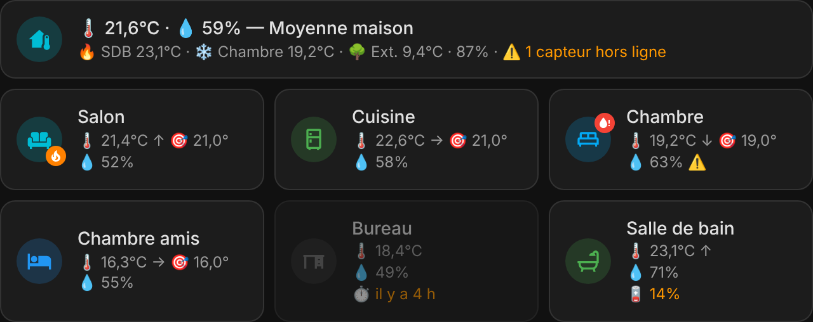

# Climascope Card

🇫🇷 [Version française](README.fr.md)

A Home Assistant Lovelace card that shows the climate of your whole home at a glance: home average, outdoor temperature and one tile per room (temperature, humidity, heating). Everything is configurable from the visual editor.

<!-- Capture d'écran : ajouter images/screenshot.png puis décommenter

-->

[](https://hacs.xyz/)

## Features

- **Home header**: average temperature and humidity, warmest and coldest room, outdoor temperature (weather entity or sensor), offline sensor alert.
- **Room tiles**: temperature, humidity, colour by temperature threshold, humidity alert badge.
- **Heating**: thermostat setpoint (🎯), heating / cooling badge, optional preset. Tapping the tile opens the thermostat.
- **Trend arrow**: ↑ ↓ → compared with one hour ago, with a configurable threshold.
- **Sensor health**: unreachable sensors and sensors that stopped reporting are greyed out, low battery is shown.
- **Exclude a room** from the header statistics (guest room, unused office…).
- **Per-room humidity thresholds** (e.g. stricter in the bathroom).
- **Compact layout**: one row per room.
- **Tap and long-press actions**, with an entity of your choice per room.
- **Long-press history graph**: temperature and/or humidity, 6 h to 30 days, all rooms or a single one.
- **Visual editor** for every option, in English and French.

## Installation

### HACS (custom repository)

1. HACS → ⋮ → **Custom repositories**.
2. Add `https://github.com/Geoffrey33/Climascope`, type **Dashboard**.
3. Search for **Climascope Card**, download it, then reload your browser.

### Manual

1. Copy `climascope-card.js` to `/config/www/`.
2. Settings → Dashboards → ⋮ → **Resources** → add `/local/climascope-card.js` as a **JavaScript module**.
3. Reload your browser (clear the cache).

## Configuration

The easiest way is the visual editor: add a card and pick **Climascope**.

### Minimal example

```yaml
type: custom:climascope-card
outdoor_entity: weather.home
rooms:
  - name: Living room
    icon: mdi:sofa
    temperature_entity: sensor.living_room_temperature
    humidity_entity: sensor.living_room_humidity
    climate_entity: climate.living_room
```

### Full example

```yaml
type: custom:climascope-card
title: Home average
outdoor_entity: weather.home
show_outdoor_humidity: false
layout: tiles
columns: 3
short_names: header
stale_after: 120
temperature_thresholds:
  - { below: 18, color: blue }
  - { below: 20, color: light-blue }
  - { below: 22, color: cyan }
  - { below: 24, color: green }
  - { below: 26, color: amber }
  - { below: 28, color: orange }
temperature_default_color: red
rooms:
  - name: Bathroom
    short_name: Bath
    icon: mdi:shower
    temperature_entity: sensor.bathroom_temperature
    humidity_entity: sensor.bathroom_humidity
    battery_entity: sensor.bathroom_battery
    humidity_high: 75
  - name: Guest room
    icon: mdi:bed
    temperature_entity: sensor.guest_room_temperature
    climate_entity: climate.guest_room
    exclude_average: true
```

### Card options

| Option | Default | Description |
| --- | --- | --- |
| `title` | `Moyenne maison` | Text after the average in the header. |
| `icon` | `mdi:home-thermometer` | Header icon. |
| `outdoor_entity` | | `weather.*` entity or temperature sensor. |
| `outdoor_humidity_entity` | | Outdoor humidity sensor (overrides the weather entity). |
| `show_average_humidity` | `true` | Average humidity in the header. |
| `show_min_max` | `true` | Warmest and coldest room. |
| `show_outdoor` / `show_outdoor_humidity` | `true` | Outdoor temperature / humidity. |
| `show_sensor_alerts` | `true` | "N sensors offline" in the header. |
| `icon_circle` | `true` | Coloured circle behind icons. |
| `short_names` | `none` | `none`, `header` or `all`. |
| `short_name_length` | `8` | Maximum length of shortened names. |
| `layout` | `tiles` | `tiles` or `compact`. |
| `columns` / `columns_mobile` | `3` / `2` | Tile columns. |
| `compact_columns` | `1` | Columns in compact layout. |
| `temperature_thresholds` | see above | List of `{ below, color }`. |
| `temperature_default_color` | `red` | Colour above the last threshold. |
| `humidity_low` / `humidity_high` | `30` / `60` | Humidity alert thresholds (%). |
| `humidity_low_color` / `humidity_high_color` | `orange` / `red` | Badge colours. |
| `show_humidity_badge` / `show_humidity_emoji` | `true` | Humidity alerts. |
| `show_setpoint` | `true` | Thermostat setpoint on the tile. |
| `show_hvac_badge` | `true` | Heating / cooling badge. |
| `show_preset` | `false` | Thermostat preset (eco, comfort…). |
| `show_trend` | `true` | Trend arrow over 1 h. |
| `trend_threshold` | `0.3` | Minimum change (°C) for ↑ / ↓. |
| `stale_after` | `120` | Minutes without a reading before a sensor is considered silent (0 = off). |
| `battery_low` | `20` | Low battery threshold (%). |
| `hold_graph` | `true` | Long press opens the history graph. |
| `graph_duration` | `24h` | `6h`, `12h`, `24h`, `3d`, `7d`, `30d`. |
| `graph_metrics` | `both` | `both`, `temperature`, `humidity`. |
| `graph_scope` | `all` | `all` or `room` (only the pressed room). |
| `graph_chart_type` | `line` | `line` or `bar`. |
| `tap_action`, `tap_entity`, `hold_action`, `hold_entity` | | Header actions. |

### Room options

| Option | Description |
| --- | --- |
| `name` | Displayed name. Empty = area name, then entity name. |
| `short_name` | Name used when names are shortened. |
| `icon` | Tile icon (default `mdi:thermometer`). |
| `temperature_entity` | Temperature sensor. |
| `humidity_entity` | Humidity sensor. |
| `climate_entity` | Thermostat: setpoint, heating badge, opened on tap. |
| `battery_entity` | Sensor battery. |
| `exclude_average` | Exclude from average and warmest / coldest room. |
| `humidity_low` / `humidity_high` | Room-specific humidity thresholds. |
| `tap_action`, `tap_entity` | Tap action (default: more-info of the thermostat, else the temperature sensor). |
| `hold_action`, `hold_entity` | Long-press action (default: history graph). |

## Notes

- **Heating badge**: the card uses the thermostat's `hvac_action` (actually heating). If the entity does not provide it, the badge reflects the HVAC mode instead.
- **Trend arrow**: compares the current value with the recorded value one hour ago (recorder history).
- **Graph**: uses long-term statistics, so sensors need a `state_class: measurement`.
- **Sensor silent**: based on `last_reported` (Home Assistant 2024.3+), otherwise `last_updated`.

## License

MIT © Geoffrey Pronier
